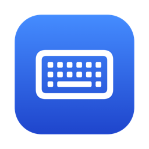

<p align="center">
  
</p>

<h1 align="center">DoubleKey</h1>

<p align="center">
  Stop your Mac keyboard from typing letters twice.<br>
  A tiny menu bar app that blocks key chatter. No setup, no per-key tuning, no CPU use.
</p>

<p align="center">
  <a href="https://github.com/fpvromadm/doublekey/actions/workflows/ci.yml"></a>
  
  <a href="LICENSE"></a>
</p>

---

Worn keyboards, and especially the MacBook butterfly keyboards from 2015 to 2019, often register one key press as two: you type `hello` and get `heello`. This is called key chatter. DoubleKey sits in the menu bar and silently drops the extra press before any app sees it.

It's inspired by [Unshaky](https://github.com/aahung/Unshaky). The difference: DoubleKey works on every key out of the box, so you don't have to find and set up each faulty key.

## Features

- **Zero setup.** Install, allow Accessibility access once, forget about it.
- **Every key covered.** No per-key list to maintain.
- **Very light.** About 220 KB on disk and 12 MB of memory. It does no work between keystrokes: no timers, no polling, no background threads of its own.
- **Private.** It has no network code. Key presses are never stored, logged or sent anywhere; it only remembers *when* each key was last released.
- **Starts at login** by itself.
- **Universal.** Runs natively on Apple Silicon and Intel Macs, macOS 13 Ventura or later.

## Install

### Download

1. Get `DoubleKey.zip` from the [latest release](https://github.com/fpvromadm/doublekey/releases/latest), unzip it and move **DoubleKey** to **Applications**.
2. The app isn't notarized by Apple, so macOS blocks the first launch. Open it once, then go to **System Settings → Privacy & Security**, scroll down and click **Open Anyway**. Or run this instead:

   ```bash
   xattr -dr com.apple.quarantine /Applications/DoubleKey.app
   ```

3. When macOS asks, allow **Accessibility** access in **System Settings → Privacy & Security → Accessibility**. DoubleKey starts working within 2 seconds; no restart needed.

A keyboard icon appears in the menu bar. It's greyed out while DoubleKey is paused or still waiting for permission.

### Build from source

You need the Xcode Command Line Tools (`xcode-select --install`).

```bash
git clone https://github.com/fpvromadm/doublekey.git
cd doublekey
./build.sh install
```

This builds the app, copies it to `/Applications` and starts it.

## Usage

Click the keyboard icon in the menu bar:

| Menu item | What it does |
| --- | --- |
| Blocked N double presses | How many presses were dropped since the app started |
| Enabled | Pause or resume filtering |
| Threshold | How close two presses must be to count as chatter (20–100 ms, default 40) |
| Launch at Login | Start DoubleKey when you log in (on by default) |
| Quit DoubleKey | Stop it |

**Still getting double letters?** Raise the threshold to 50, 60 or 80 ms.
**Losing letters you meant to type twice?** Lower it to 30 ms.

## How it works

A key press goes *down* then *up*. A chattering switch makes extra contact right after you let go, so the system sees *down, up, down, up* for a single press.

DoubleKey installs a keyboard event tap and applies one rule:

> If a key goes down less than *threshold* ms after the **same** key went up, and no other key was pressed in between, drop that press and its release.

Even fast typists take far longer than 40 ms between releasing a key and pressing it again, so real double letters like `ll` or `ee` go through. Held keys and auto-repeat are never touched. Modifier keys (⌘ ⌥ ⌃ ⇧) are not filtered.

The whole logic is about 40 lines in [`Sources/Debouncer.swift`](Sources/Debouncer.swift), with tests in [`Tests/main.swift`](Tests/main.swift).

## Development

```bash
./build.sh          # build build/DoubleKey.app
./build.sh test     # run the debounce tests
./build.sh install  # build, copy to /Applications and start
```

No Xcode project: it's plain `swiftc` and a shell script.

**Keeping the Accessibility permission across rebuilds.** macOS ties the permission to the app's code signature. By default `build.sh` signs ad-hoc, so after each rebuild you need to remove DoubleKey from the Accessibility list and add it again. To avoid that, create a local signing certificate once:

```bash
./scripts/make-signing-cert.sh
```

It creates a self-signed "DoubleKey Local Signing" certificate in your login keychain, trusted for code signing only, and `build.sh` uses it from then on. You can also set `SIGN_ID` to any identity you already have.

**Releases.** Pushing a tag like `v1.1` builds the app on GitHub Actions and attaches `DoubleKey.zip` to a new release.

## Uninstall

1. Click the menu bar icon → **Quit DoubleKey**.
2. Delete `/Applications/DoubleKey.app`.
3. Remove DoubleKey from **System Settings → Privacy & Security → Accessibility** and from **General → Login Items**.
4. Optionally delete its settings:

   ```bash
   defaults delete io.github.fpvromadm.doublekey
   ```

## License

[MIT](LICENSE)
